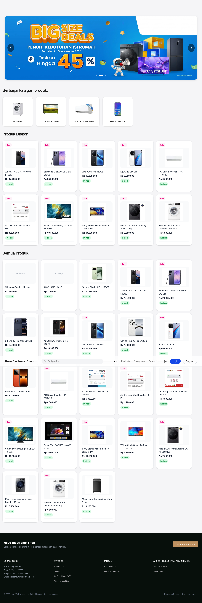

# Revo Electronics Shop (RevoShop)

RevoShop adalah aplikasi web toko online elektronik yang dibangun dengan **Next.js (App Router)**, **TypeScript**, dan **Tailwind CSS**. Data produk dan kategori diambil dari **API backend Flask** (di-deploy di Render). Aplikasi dilengkapi pencarian, halaman detail, keranjang belanja berbasis React Context, checkout/buat pesanan, register/login (User & Admin), serta panel admin (terproteksi) untuk mengelola produk, pesanan, dan role user.

🔗 **Live demo:** https://revoshop-seven.vercel.app


## Tampilan

### Beranda



## Fitur

- **Daftar produk** dari API backend, ditampilkan sebagai kartu (`ProductCard`).
- **Pencarian produk** dari header; difilter di backend lewat `?q=` pada `/products`.
- **Kategori**: daftar di beranda dan di `/categories`; tiap kategori membuka `/categories/[slug]`.
- **Produk diskon** (sale) lewat filter `?is_sale=true`.
- **Detail produk** di `/products/[id]`.
- **Keranjang belanja** (`/cart`) berbasis React Context (`CartContex.tsx`, hook `useCart()`), dengan badge jumlah item di header.
- **Register** di `/register` dengan validasi: username wajib, format email, password minimal 8 karakter, dan konfirmasi password harus sama. Error 409 (email sudah terdaftar) ditampilkan di form.
- **Login** di `/login` dengan toggle **User / Admin** (endpoint berbeda untuk tiap mode).
- **Add to Cart wajib login**: jika belum login, klik *Add to Cart* mengarahkan ke `/login?redirect=<halaman-asal>`; setelah login berhasil, user dikembalikan ke halaman tersebut (jika tidak ada `redirect`, user ke `/`, admin ke `/admin`).
- **Admin**: lihat daftar produk, tambah produk (dengan upload foto), dan edit produk (foto lama tetap dipakai bila tidak memilih foto baru).
- **Loading & error state** per halaman (`loading.tsx`, `error.tsx`) untuk cart, produk, dan kategori.
- Gambar produk/kategori ditampilkan dengan `next/image`.

### Autentikasi

Status login disimpan di `localStorage` pada browser:

- `user`: objek user (`id`, `username`, `email`, `role`) setelah register/login berhasil.
- `token`: disimpan hanya jika backend mengirim `token` atau `access_token`.

Pengecekan login di sisi frontend dilakukan oleh `isLoggedIn()` di `lib/auth.ts` (true jika `user.id` ada).

> Catatan: halaman `/admin/*` saat ini belum memiliki guard/proteksi route di frontend.

## Teknologi

| Paket                                       | Versi (terpasang) |
| ------------------------------------------- | ----------------- |
| [Next.js](https://nextjs.org/) (App Router) | 16.4.2            |
| [React](https://react.dev/) / React DOM     | 19.3.0            |
| [TypeScript](https://www.typescriptlang.org/) | 5.9.3           |
| [Tailwind CSS](https://tailwindcss.com/)    | 4.3.3             |
| ESLint + `eslint-config-next`               | 9 / 16.4.2        |

`next.config.ts` mengaktifkan `cacheComponents` dan `partialPrefetching`, serta mengatur `images.remotePatterns` untuk host backend.

## Routes

| Route                         | Keterangan                                      |
| ----------------------------- | ----------------------------------------------- |
| `/`                           | Beranda: carousel, kategori, produk diskon, semua produk |
| `/products`                   | Daftar produk + hasil pencarian (`?q=`)         |
| `/products/[id]`              | Detail produk + Add to Cart                     |
| `/categories`                 | Daftar kategori                                 |
| `/categories/[slug]`          | Produk berdasarkan kategori                     |
| `/cart`                       | Keranjang belanja                               |
| `/orders`                     | Halaman pesanan (masih sederhana/stub)          |
| `/orders/[id]`                | Detail pesanan (masih stub, hanya menampilkan ID) |
| `/register`                   | Form register                                   |
| `/login`                      | Form login (toggle User/Admin, mendukung `?redirect=`) |
| `/admin`                      | Dashboard admin                                 |
| `/admin/products`             | Daftar produk (tabel) + tautan Edit             |
| `/admin/add_product`          | Form tambah produk                              |
| `/admin/edit_product/[id]`    | Form edit produk                                |

## Struktur Proyek

```
revoshop/
├── app/
│   ├── layout.tsx                 # Layout utama (Header, Footer, CartProvider)
│   ├── page.tsx                   # Beranda
│   ├── login/page.tsx             # Halaman login
│   ├── register/page.tsx          # Halaman register
│   ├── cart/                      # Keranjang (page, loading, error)
│   ├── products/                  # Daftar produk (layout, page, loading, error)
│   │   └── [id]/                  # Detail produk (page, loading, error)
│   ├── categories/
│   │   ├── page.tsx               # Daftar kategori
│   │   └── [slug]/                # Produk per kategori (page, loading, error)
│   ├── orders/                    # Pesanan (page + [id]/page)
│   └── admin/
│       ├── layout.tsx
│       ├── page.tsx               # Dashboard admin
│       ├── products/page.tsx      # Daftar produk admin
│       ├── add_product/page.tsx   # Tambah produk
│       └── edit_product/[id]/page.tsx  # Edit produk
├── components/
│   ├── Header.tsx / Footer.tsx
│   ├── CartContex.tsx             # CartProvider & useCart
│   ├── CartSummary.tsx, QtySelector.tsx, AddToCart.tsx
│   ├── ProductCard.tsx, AllProducts.tsx, SaleProducts.tsx, CategoryList.tsx, Carousel.tsx
│   ├── LoginForm.tsx, RegisterForm.tsx
│   ├── ProductForm.tsx            # Form tambah/edit produk
│   └── pageSection.tsx            # Card, PageSection, Modal
├── data/
│   ├── products.ts                # Fetch produk
│   └── category.ts                # Fetch kategori
├── lib/
│   └── auth.ts                    # isLoggedIn()
├── types/
│   └── product.ts                 # Product, Category, CartItem, RegisterFormData, dll.
├── public/                        # Aset statis (images, screenshots, ikon)
├── next.config.ts
├── .env.example
└── package.json
```

## Persyaratan

- [Node.js](https://nodejs.org/) (versi yang didukung Next.js 16, minimal 20.9 disarankan).
- npm.
- API backend Flask yang berjalan (lokal atau di Render), lihat [Backend API](#backend-api).

## Cara Menjalankan (Lokal)

```bash
cd revoshop
npm install
cp .env.example .env.local   # Windows PowerShell: Copy-Item .env.example .env.local
npm run dev
```

Buka [http://localhost:3000](http://localhost:3000).

## Skrip npm

| Perintah        | Keterangan                       |
| --------------- | -------------------------------- |
| `npm run dev`   | Menjalankan server pengembangan  |
| `npm run build` | Membuat build produksi           |
| `npm run start` | Menjalankan hasil build produksi |
| `npm run lint`  | Menjalankan ESLint               |

## Environment

Salin `.env.example` menjadi `.env.local`, lalu isi:

| Variabel                   | Keterangan                          | Contoh                                              |
| -------------------------- | ----------------------------------- | --------------------------------------------------- |
| `NEXT_PUBLIC_API_BASE_URL` | Alamat dasar (base URL) API backend | `http://localhost:5000` atau `https://your-backend.onrender.com` |

Catatan:
- Variabel berawalan `NEXT_PUBLIC_` dapat diakses dari browser.
- `.env.local` tidak ikut ter-commit (diabaikan oleh `.gitignore`).
- Jalankan ulang `npm run dev` setelah mengubah `.env.local`. Di Vercel, isi variabel ini di **Environment Variables** lalu redeploy.
- `LoginForm` dan `RegisterForm` memakai `http://localhost:5000` sebagai fallback bila variabel kosong.

## Backend API

Endpoint yang dipanggil frontend (semua relatif terhadap `NEXT_PUBLIC_API_BASE_URL`):

| Metode | Endpoint                    | Dipakai untuk                                   |
| ------ | --------------------------- | ----------------------------------------------- |
| POST   | `/users/`                   | Register (`username`, `email`, `password_hash`) |
| POST   | `/user/login`               | Login user                                      |
| POST   | `/admin/login`              | Login admin                                     |
| GET    | `/products/`                | Daftar produk                                   |
| GET    | `/products/?q=<kata>`       | Cari produk                                     |
| GET    | `/products/?is_sale=true`   | Produk diskon                                   |
| GET    | `/products/?category=<slug>`| Produk per kategori                             |
| GET    | `/products/<id>`            | Detail produk (juga untuk prefill form edit)    |
| POST   | `/products/`                | Tambah produk (`multipart/form-data`)           |
| PUT    | `/products/<id>`            | Edit produk (`multipart/form-data`)             |
| GET    | `/categories/`              | Daftar kategori                                 |

Respons register sukses (201) berisi `{ id, username, email, role }`; email yang sudah terdaftar mengembalikan 409 dengan `{ "error": "..." }`.

Contoh respons produk:

```json
{
  "id": 1,
  "name": "Samsung A36 5G",
  "sku": "samsung_A36",
  "price": 4500000,
  "stock": 30,
  "category_id": 2,
  "category_name": "Handphone",
  "is_sale": false,
  "is_in_stock": true,
  "is_deleted": false,
  "image": "/static/uploads/xxxx.jpg",
  "created_at": "2026-09-03T03:02:05.823367"
}
```

> Gambar (`image`) berupa path relatif backend (mis. `/static/uploads/...`). Host backend harus terdaftar di `images.remotePatterns` pada `next.config.ts` (saat ini `localhost:5000` dan `backend-electronic-indra.onrender.com`). Jika memakai backend lain, tambahkan hostname-nya di sana.

## Catatan

- **CORS**: `RegisterForm`, `LoginForm`, dan `ProductForm` memanggil backend langsung dari browser, jadi backend Flask harus mengizinkan origin frontend (mis. `http://localhost:3000` dan domain Vercel) lewat CORS.
- **Cold start Render**: backend di free tier Render tidur saat tidak dipakai, sehingga request pertama bisa lambat (puluhan detik) atau sempat gagal. Coba lagi setelah backend aktif.
- **Server Components + Suspense**: pengambilan data produk/kategori dilakukan di server component dan dibungkus `<Suspense>` karena `cacheComponents` aktif.
- **Cart**: state keranjang hanya ada di memori React Context (`CartProvider` di `app/layout.tsx`), belum dikirim ke backend.

## Deploy ke Vercel

### Opsi A — Dashboard (GitHub, auto-deploy)

1. Masuk ke [vercel.com](https://vercel.com/) dengan akun GitHub.
2. **Add New… → Project**, import repository `Revo_Electronics_shop`.
3. Biarkan setelan build default (Next.js terdeteksi otomatis).
4. Tambahkan `NEXT_PUBLIC_API_BASE_URL` berisi URL backend produksi.
5. Klik **Deploy**. Setiap `git push` akan memicu deploy otomatis.

### Opsi B — Vercel CLI

```bash
npm install -g vercel
vercel login
vercel          # preview
vercel --prod   # produksi
vercel env add NEXT_PUBLIC_API_BASE_URL
```

Pilih environment **Production** dan isi URL backend, lalu jalankan `vercel --prod` lagi.
