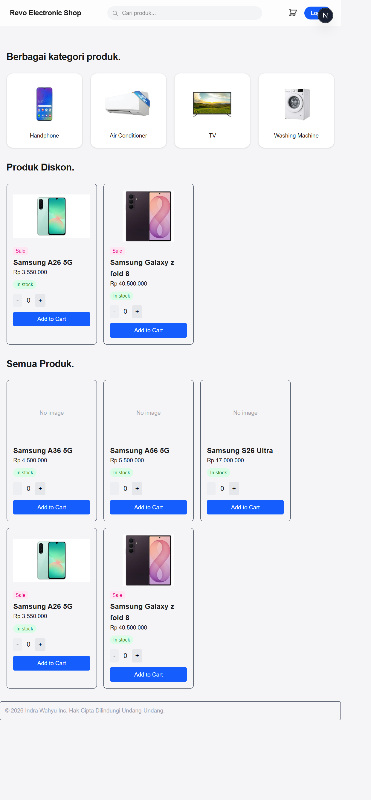

# Revo Electronics Shop

Revo Electronics Shop adalah aplikasi web toko online elektronik yang dibangun dengan **Next.js (App Router)**, **TypeScript**, dan **Tailwind CSS**. Aplikasi menampilkan daftar produk dan kategori yang diambil dari **API backend**, dilengkapi pencarian produk, halaman detail, dan keranjang belanja (cart) interaktif berbasis React Context.

🔗 **Live demo:** https://revoshop-seven.vercel.app

## Tampilan

### Beranda



## Fitur

- **Daftar produk** diambil dari API backend dan ditampilkan sebagai kartu (`ProductCard`).
- **Pencarian produk** dari header; hasil difilter di backend melalui query `?q=` pada halaman `/products`.
- **Daftar kategori** di beranda; tiap kategori mengarah ke `/categories/[id]`.
- **Produk diskon** (sale) ditampilkan terpisah melalui filter `?is_sale=true`.
- **Halaman detail produk** di `/products/[id]`.
- **Keranjang belanja (cart)** berbasis React Context:
  - Tombol *Add to Cart* menambah produk ke keranjang.
  - Badge jumlah item di ikon keranjang pada header diperbarui otomatis.
  - Halaman `/cart` menampilkan item, subtotal, total, dan tombol hapus.
- **Gambar produk/kategori** dari backend ditampilkan dengan `next/image`.
- **Status stok** melalui komponen `Badge` (In stock / Out of stock).
- Tipe data terpusat di `types/product.ts` menggunakan `interface` TypeScript.
- Konfigurasi alamat API lewat variabel lingkungan.

## Teknologi

- [Next.js](https://nextjs.org/) 16 (App Router, Turbopack, Cache Components)
- [React](https://react.dev/) 19
- [TypeScript](https://www.typescriptlang.org/) 5
- [Tailwind CSS](https://tailwindcss.com/) 4

## Struktur Proyek

```
revoshop/
├── app/
│   ├── layout.tsx            # Layout utama (Header, Footer, CartProvider)
│   ├── page.tsx              # Beranda: pencarian, kategori, produk diskon, semua produk
│   ├── globals.css           # Style global
│   ├── cart/
│   │   └── page.tsx          # Halaman keranjang belanja
│   ├── products/
│   │   ├── page.tsx          # Daftar produk + hasil pencarian (?q=)
│   │   └── [id]/page.tsx     # Detail produk
│   ├── categories/
│   │   └── [id]/page.tsx     # Produk berdasarkan kategori
│   ├── orders/
│   │   └── [id]/page.tsx     # Detail pesanan (stub)
│   └── add-product/
│       └── page.tsx          # Form tambah produk (ProductForm)
├── components/
│   ├── Header.tsx            # Header: navigasi, search, ikon cart + badge
│   ├── Footer.tsx            # Footer
│   ├── CartContex.tsx        # React Context untuk state keranjang (CartProvider, useCart)
│   ├── CartSummary.tsx       # Ringkasan total keranjang
│   ├── ProductCard.tsx       # Kartu produk
│   ├── AllProducts.tsx       # Ambil & tampilkan semua produk (server component)
│   ├── SaleProducts.tsx      # Ambil & tampilkan produk diskon (server component)
│   ├── CategoryList.tsx      # Ambil & tampilkan daftar kategori (server component)
│   ├── QtySelector.tsx       # Pemilih jumlah (quantity)
│   ├── AddToCart.tsx         # Tombol tambah ke keranjang
│   ├── ProductForm.tsx       # Form produk
│   └── pageSection.tsx       # Komponen pembungkus (Card, PageSection, Modal)
├── data/
│   ├── products.ts           # Fungsi fetch produk (getAllProducts, getSaleProducts, ...)
│   └── category.ts           # Fungsi fetch kategori (getCategories, ...)
├── types/
│   └── product.ts            # Definisi interface & type (Product, Category, CartItem, dsb.)
├── public/                   # Aset statis (gambar, ikon)
├── next.config.ts            # Konfigurasi Next.js (images.remotePatterns, dll)
├── .env.example              # Contoh variabel lingkungan
└── package.json
```

## Persyaratan

- [Node.js](https://nodejs.org/) versi 18.18 atau lebih baru.
- npm (sudah termasuk saat memasang Node.js).
- API backend yang menyediakan endpoint produk & kategori (lihat bagian [Backend API](#backend-api)).

## Cara Menjalankan (Lokal)

1. Masuk ke folder proyek:

   ```bash
   cd revoshop
   ```

2. Pasang dependensi:

   ```bash
   npm install
   ```

3. Siapkan environment (lihat bagian [Environment](#environment)):

   ```bash
   cp .env.example .env.local
   ```

4. Jalankan server pengembangan:

   ```bash
   npm run dev
   ```

5. Buka [http://localhost:3000](http://localhost:3000) di browser.

## Skrip npm

| Perintah        | Keterangan                              |
| --------------- | --------------------------------------- |
| `npm run dev`   | Menjalankan server pengembangan         |
| `npm run build` | Membuat build produksi                  |
| `npm run start` | Menjalankan hasil build produksi        |
| `npm run lint`  | Menjalankan ESLint                      |

## Environment

Buat file `.env.local` di folder `revoshop/` dengan isi berikut:

| Variabel                   | Keterangan                          | Contoh                  |
| -------------------------- | ----------------------------------- | ----------------------- |
| `NEXT_PUBLIC_API_BASE_URL` | Alamat dasar (base URL) API backend | `http://localhost:5000` |

Catatan:
- Variabel berawalan `NEXT_PUBLIC_` dapat diakses dari sisi browser.
- `.env.local` tidak ikut ter-commit (ada di `.gitignore`).
- Setelah mengubah `.env.local`, jalankan ulang `npm run dev`.

## Backend API

Aplikasi mengambil data dari API backend melalui `NEXT_PUBLIC_API_BASE_URL`. Endpoint yang digunakan:

| Metode | Endpoint                 | Keterangan                                   |
| ------ | ------------------------ | -------------------------------------------- |
| GET    | `/products/`             | Daftar semua produk                          |
| GET    | `/products/?q=<kata>`    | Cari produk berdasarkan nama                 |
| GET    | `/products/?is_sale=true`| Daftar produk yang sedang diskon             |
| GET    | `/products/<id>`         | Detail satu produk                           |
| GET    | `/categories/`           | Daftar semua kategori                        |

Bentuk respons produk (contoh):

```json
{
  "id": 1,
  "name": "Samsung A36 5G",
  "sku": "samsung_A36",
  "price": 4500000,
  "stock": 30,
  "category_id": 2,
  "category_name": "Handphone",
  "is_sale": false,
  "is_in_stock": true,
  "is_deleted": false,
  "image": "/static/uploads/xxxx.jpg",
  "created_at": "2026-09-03T03:02:05.823367"
}
```

> Gambar (`image`) dapat berupa path relatif pada backend (mis. `/static/uploads/...`). Pastikan host backend didaftarkan pada `images.remotePatterns` di `next.config.ts` agar dapat dimuat oleh `next/image`.

## Catatan Teknis

- **Server Components + Suspense**: pengambilan data (produk, kategori) dilakukan di server component dan dibungkus `<Suspense>` karena proyek mengaktifkan Cache Components. Pengambilan server-side juga menghindari masalah CORS pada fetch dari browser.
- **React Context untuk cart**: state keranjang disediakan oleh `CartProvider` (di `components/CartContex.tsx`) yang membungkus seluruh aplikasi melalui `app/layout.tsx`, dan diakses dengan hook `useCart()`.
- **Konfigurasi gambar**: `next.config.ts` mengatur `images.remotePatterns` untuk mengizinkan gambar dari host backend.

## Deploy ke Vercel

Proyek ini dapat di-deploy ke [Vercel](https://vercel.com/).

### Opsi A — Melalui Dashboard (GitHub, auto-deploy)

1. Masuk ke [vercel.com](https://vercel.com/) menggunakan akun GitHub.
2. Klik **Add New… → Project**, lalu **Import** repository `Revo_Electronics_shop`.
3. Vercel mendeteksi Next.js secara otomatis; biarkan setelan build default.
4. Pada **Environment Variables**, tambahkan `NEXT_PUBLIC_API_BASE_URL` berisi URL backend produksi.
5. Klik **Deploy**. Setiap `git push` berikutnya akan memicu deploy otomatis.

### Opsi B — Melalui Vercel CLI

1. Install CLI dan login:

   ```bash
   npm install -g vercel
   vercel login
   ```

2. Deploy dari folder `revoshop/`:

   ```bash
   vercel          
   vercel --prod   
   ```

3. Tambahkan environment variable produksi:

   ```bash
   vercel env add NEXT_PUBLIC_API_BASE_URL
   ```

   Pilih environment **Production**, lalu isi dengan URL backend produksi. Jalankan `vercel --prod` untuk menerapkannya.

## Tampilan

### Beranda
